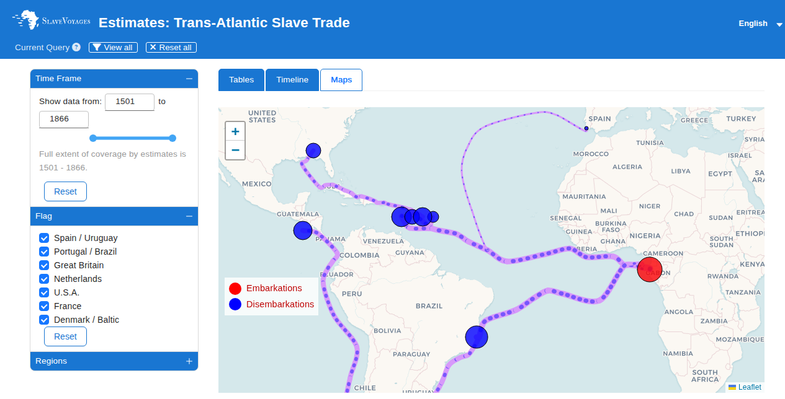

# Atividade prática: SlaveVoyages

Atividade separada da apresentação principal; conteúdo transposto do QMD legado.

## Slide 1 — Atividade prática: SlaveVoyages

# Atividade prática: SlaveVoyages {.center}

## Slide 2 — Explorando o tráfico atlântico de escravizados

## Explorando o tráfico atlântico de escravizados {.center}

🔗 [**slavevoyages.org/assessment/estimates**](https://www.slavevoyages.org/assessment/estimates)

## Slide 3 — O que é o SlaveVoyages?

## O que é o SlaveVoyages? {.center}

- Base de dados digital sobre o tráfico transatlântico de africanos escravizados
- Compila estimativas baseadas em registros documentais de viagens (1501–1866)
- Permite **pesquisar, filtrar, visualizar e baixar dados** sobre o tráfico
- Três modos de visualização: **Tabelas**, **Linha do tempo** e **Mapas interativos**
- Ferramenta fundamental para a historiografia da escravidão atlântica

## Slide 4 — Parâmetros de busca disponíveis

## Parâmetros de busca disponíveis {.center}

:::incremental
- **Time Frame**: período (1501–1866), com slider e campos numéricos
- **Flag** (Portadora nacional): Spain/Uruguay, Portugal/Brazil, Great Britain, Netherlands, U.S.A., France, Denmark/Baltic
- **Regions** → **Embarkation Regions** (regiões de embarque na África)
- **Regions** → **Disembarkation Regions** (regiões de desembarque nas Américas): subdivididas por império
:::

## Slide 5 — Busca 1: Volume do tráfico para o Caribe britânico

## Busca 1: Volume do tráfico para o Caribe britânico {.center}

**Objetivo**: visualizar a escala da escravidão nas ilhas produtoras de açúcar

## Slide 6 — Busca 1: Volume do tráfico para o Caribe britânico

## Busca 1: Volume do tráfico para o Caribe britânico {.center}

:::incremental
1. **Time Frame**: 1601–1800
1. **Flag**: deixar todos selecionados
1. **Regions** → desmarcar todos os Disembarkation Regions, exceto: **Jamaica**, **Barbados**, **Antigua**, **St. Kitts**, **Grenada**, **Dominica**, **Other British Caribbean**
1. Mudar para a tab **Timeline** → observar o pico de desembarques
1. Mudar para a tab **Maps** → visualizar os fluxos
:::

## Slide 7 — Questão para discussão

## {.center}

**Pergunta**: Em que período o tráfico para o Caribe britânico atingiu seu pico? Como isso se relaciona com a transição do tabaco para o açúcar?

## Slide 8 — Busca 2: Comparação Caribe britânico vs. Saint-Domingue

## Busca 2: Comparação Caribe britânico vs. Saint-Domingue {.center}

**Objetivo**: comparar o volume de cativos nas duas maiores potências açúcarneiras

## Slide 9 — Busca 2: Comparação Caribe britânico vs. Saint-Domingue

## Busca 2: Comparação Caribe britânico vs. Saint-Domingue {.center}

:::incremental
1. **Time Frame**: 1701–1800
1. **Flag**: Great Britain + France (desmarcar os demais)
1. **Disembarkation Regions**: marcar **Jamaica**, **Barbados** (britânicas) e **Saint-Domingue**, **Martinique**, **Guadeloupe** (francesas)
1. Tab **Tables** → Rows: "50-year periods"; Columns: "Disembarkation regions"; Cells: "Only embarked"
1. Observar os números absolutos por ilha
:::

## Slide 10 — Questão para discussão

## {.center}
**Pergunta**: Qual ilha recebeu mais cativos no século XVIII? Como isso se reflete na produção açucareira descrita por Klein & Vision III?

## Slide 11 — Busca 3: Origens africanas — de onde vinham os escravizados?

## Busca 3: Origens africanas — de onde vinham os escravizados? {.center}

**Objetivo**: mapear as regiões de embarque na África que abasteceram o Caribe

## Slide 12 — Busca 3: Origens africanas — de onde vinham os escravizados?

## Busca 3: Origens africanas — de onde vinham os escravizados? {.center}

:::incremental
1. **Time Frame**: 1651–1800
1. **Flag**: manter todos
1. **Disembarkation Regions**: marcar apenas as ilhas do Caribe (Jamaica, Barbados, Saint-Domingue, Martinique, Guadeloupe, Dutch Caribbean)
1. Tab **Tables** → Rows: "50-year periods"; Columns: "Embarkation regions"
1. Observar quais regiões africanas predominam em cada período
:::

## Slide 13 — Questão para discussão

## {.center}

**Pergunta**: Qual região africana forneceu mais cativos para o Caribe? Houve mudança nas origens ao longo do século XVIII?

## Slide 14 — Busca 4: Holandeses — império de contrabando

## Busca 4: Holandeses — império de contrabando {.center}

**Objetivo**: evidenciar o papel holandês no tráfico e seu deslocamento para as Guianas

## Slide 15 — Busca 4: Holandeses — império de contrabando

## Busca 4: Holandeses — império de contrabando {.center}
:::incremental
1. **Time Frame**: 1601–1800
1. **Flag**: marcar apenas **Netherlands**
1. **Disembarkation Regions**: manter todos
1. Tab **Tables** → Rows: "50-year periods"; Columns: "Disembarkation regions"
1. Tab **Timeline** → observar a curva ao longo do tempo
:::

## Slide 16 — Questão para discussão

## {.center}

**Pergunta**: Para onde os holandeses direcionaram seus cativos após perderem o controle das ilhas? Como isso dialoga com a tese de Klein & Vision III sobre o papel holandês?

## Slide 17 — Busca 5: O minúsculo tráfico para a América do Norte

## Busca 5: O minúsculo tráfico para a América do Norte {.center}

**Objetivo**: contrastar a escala do Caribe com a América do Norte britânica

## Slide 18 — Busca 5: O minúsculo tráfico para a América do Norte

## Busca 5: O minúsculo tráfico para a América do Norte {.center}

:::incremental
1. **Time Frame**: 1501–1866
1. **Disembarkation Regions**: desmarcar tudo, marcar apenas **Chesapeake**, **Carolinas/Georgia**, **Northern U.S.**, **Gulf states**, **U.S.A. unspecified**
1. Tab **Timeline** → comparar visualmente com a Busca 1
:::

## Slide 19 — Questão para discussão

## {.center}

**Pergunta**: Menos de 4% dos cativos desembarcaram na América do Norte. Como essa proporção ajuda a entender por que as colônias norte-americanas desenvolveram dinâmicas sociais tão diferentes das caribenhas?

## Slide 20 — Como exportar e discutir os dados

## Como exportar e discutir os dados {.center}

:::incremental
- **Download Table**: botão na tab Tables → exporta CSV para análise
- **Download Timeline Data**: botão na tab Timeline → dados anuais
- **Screenshot dos mapas**: use para documentar suas observações em sala
:::
